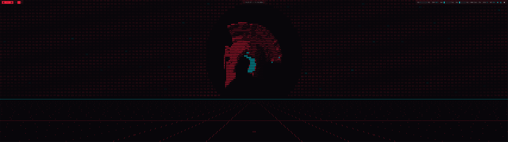
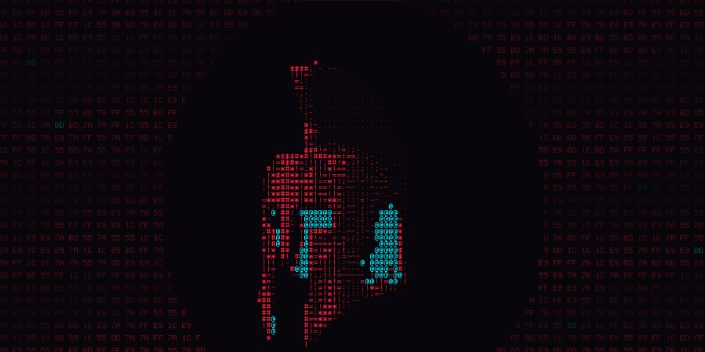
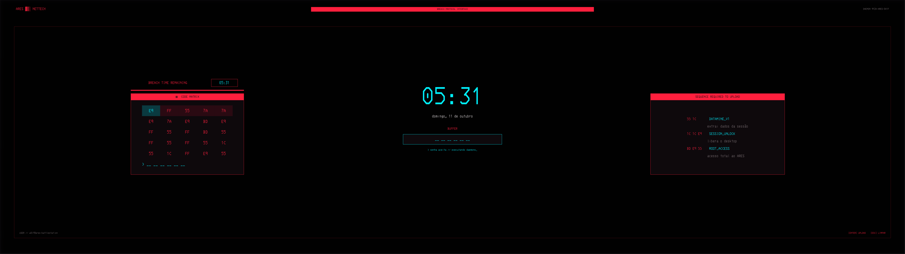
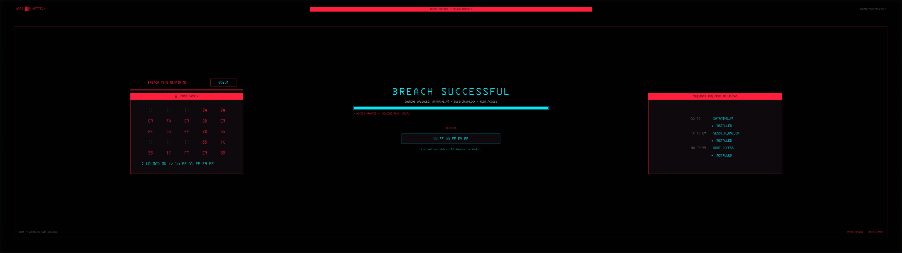
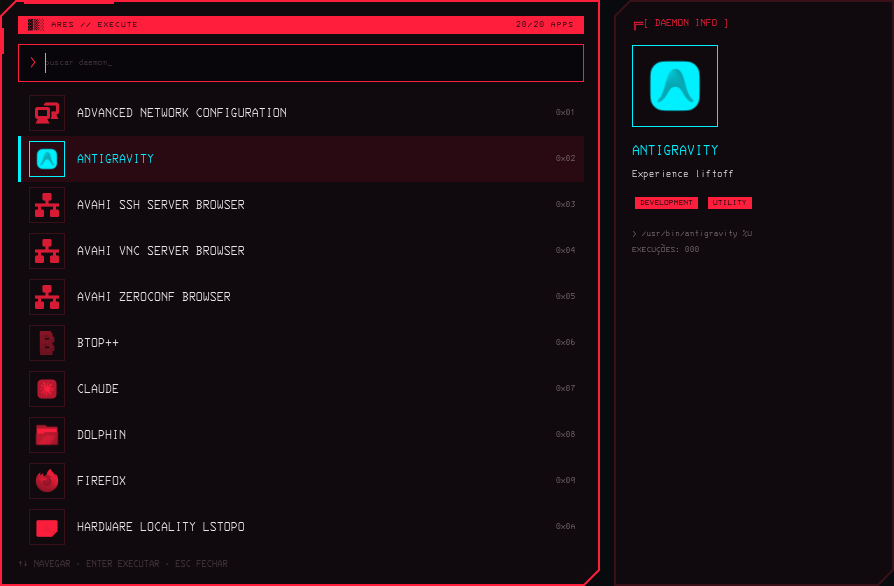
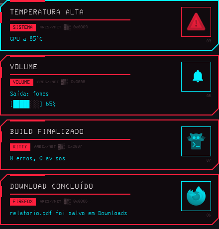
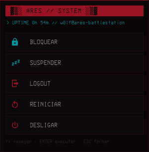
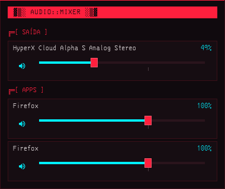
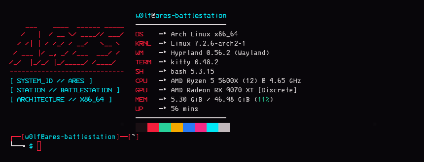

# dotfiles

Configs do meu Arch Linux + Hyprland (ARES) — tema **Cyber-Red** (vermelho = estrutura,
ciano = dados), fonte IBM 3270 Nerd Font, visual retrô/cyberpunk.

## Destaques

- **Login/bloqueio Breach Protocol**: o greetd faz login automático e o Hyprland já abre
  travado no hyprlock no estilo do minigame do Cyberpunk 2077. Ao desbloquear, uma animação
  continua o HUD: a CODE MATRIX é resolvida, os daemons são instalados e aparece
  BREACH SUCCESSFUL. Logout cai no tuigreet.
- **Notificações próprias** (`ares_notifyd.py`): servidor org.freedesktop.Notifications em
  GTK4 com cantos cortados e o ícone do app em holograma numa moldura (substitui o dunst).
- **Lançador próprio** (`ares_launcher.py`, Super+Espaço): HUD com cantos cortados, busca
  aproximada, apps mais usados no topo, painel DAEMON INFO e ícones em holograma.
- **Wallpaper animado**: capacete espartano de Ares em ASCII 3D (estilo "donut ASCII"),
  girando sobre uma grade em perspectiva com matriz hex no céu — shader GLSL no `mpvpaper`.
- **Waybar**: medidores ASCII, mixer de volume por app, toggle claro/escuro e menu do
  sistema no badge ARES (bloquear, suspender, logout, reiniciar, desligar).

## Prints

**Wallpaper animado** (capacete de Ares em ASCII 3D, grade e matriz hex)



**Tela de bloqueio — Breach Protocol** (início da animação de desbloqueio, que reproduz o HUD do hyprlock)


**Desbloqueio — BREACH SUCCESSFUL** (matriz resolvida, buffer cheio, daemons instalados)


**Barra** (badge ARES, relógio, medidores ASCII, mixer e tema)


| Lançador (Super+Espaço) | Notificações |
|---|---|
|  |  |

| Menu do sistema (badge ARES) | Mixer de volume | Terminal |
|---|---|---|
|  |  |  |

## Wallpaper animado

`hypr/scripts/wallpaper.sh` roda o `mpvpaper` com o shader
`home/.config/ares/wallpaper/ares_helmet.glsl` sobre um vídeo vazio (lavfi) do tamanho do
monitor, a 30 FPS, pausando quando o fundo está coberto. Sem `mpvpaper`, cai no `hyprpaper`.

O shader é **gerado** — edite os geradores, não o `.glsl`:

```bash
# (opcional) trocar o modelo: converte um .glb/.gltf/.zip em voxels 64³
python3 tools/voxelize_model.py ~/Downloads/modelo.glb --size 64
# gera o shader (embute os voxels, se existirem) e reinicia o fundo
python3 tools/gen_wallpaper_shader.py && setsid -f ~/.config/hypr/scripts/wallpaper.sh
```

Ajustes no topo do shader gerado (via `tools/gen_wallpaper_shader.py`): `SPIN_SPEED`,
`GRID_SPEED`, `HORIZON`, `HELMET_Y`, `HELMET_SIZE`, `VOX_ZOOM`.

## Créditos

- Modelo do capacete: **"3D Spartan Helmet - High Poly"** por **Manix3D**, licença
  [CC BY 4.0](https://creativecommons.org/licenses/by/4.0/) —
  <https://sketchfab.com/3d-models/3d-spartan-helmet-high-poly-25e66a8915254fbc9402b0ef96a90554>.
  Adaptado: convertido em voxels 64³ e renderizado em ASCII
  (`home/.config/ares/wallpaper/helmet_vox.bin`, embutido no shader).

## Efeitos sonoros

Painéis, notificações, bloqueio e desbloqueio tocam sons via `ares_sfx.py`. O repo traz um
pacote **sintetizado** (`home/.config/ares/sounds/`, gerado por `tools/gen_sounds.py`).
Sons próprios (ex.: extraídos da sua cópia do Cyberpunk 2077) vão em
`~/.local/share/ares/sounds/<nome>.(wav|ogg|flac|mp3)` — têm prioridade e **não entram no repo**
(o `.gitignore` bloqueia por segurança). Faça backup dessa pasta à parte.
Nomes: key nav select open close error pick success notify alert lock tick.
Volume/desligar: `~/.config/ares/sfx.conf`.

## Instalar numa máquina nova

```bash
git clone https://github.com/vitorSiqueiraLobao/dotfiles.git ~/dotfiles
cd ~/dotfiles
./install.sh
```

O script:

1. instala os pacotes de `pkglist.txt` (pacman) e `pkglist-aur.txt` (yay);
2. cria symlinks de tudo que está em `home/` para o mesmo caminho em `~`
   (arquivos existentes vão para `~/.dotfiles-backup/<data>/`);
3. copia `system/etc/` para `/etc` e regera o initramfs;
4. aplica o modo escuro via gsettings.

Só os links, sem instalar nada: `./install.sh --links`

## Estrutura

| Caminho | O que é |
|---|---|
| `home/.config/hypr/` | Hyprland (Lua), hyprlock, hyprpaper, wallpaper |
| `home/.config/waybar/` | Barra + scripts (GPU, áudio, toggle claro/escuro) |
| `home/.config/{kitty,wofi,dunst,btop,fastfetch}/` | Terminal, launcher, notificações, monitores |
| `home/.config/gtk-{3,4}.0/` | Tema/CSS do GTK |
| `home/.XCompose` | `' + c` → `ç` no layout US internacional |
| `home/.bashrc`, `home/.bash_profile` | Shell |
| `home/.config/hypr/scripts/` | lock.sh + Breach Protocol (matriz, sequência, animação), notifyd, screenshot |
| `home/.config/systemd/user/`, `home/.local/share/dbus-1/` | Ativação do ARES notifyd no lugar do dunst |
| `home/.config/ares/wallpaper/` | Shader do wallpaper animado + voxels do capacete |
| `tools/` | Geradores: sons, shader do wallpaper, conversor de modelo 3D |
| `system/etc/modprobe.d/amdgpu-frl.conf` | HDMI 2.1 FRL no amdgpu (5120x1440@240 via HDMI, kernel ≥ 7.2) |
| `system/etc/greetd/config.toml` | Login automático no Hyprland + tuigreet no logout |

## Notas

- Os caminhos assumem o usuário `w0lf` (ex.: `/home/w0lf/.config/hypr/wallpaper.png`).
- Como as configs são symlinks para este repo, qualquer mudança já aparece no `git status`.
  Para salvar: `git add -A && git commit -m "..." && git push`.
- Atualizar a lista de pacotes:
  `pacman -Qqen > pkglist.txt && pacman -Qqem | grep -v -- -debug > pkglist-aur.txt`
